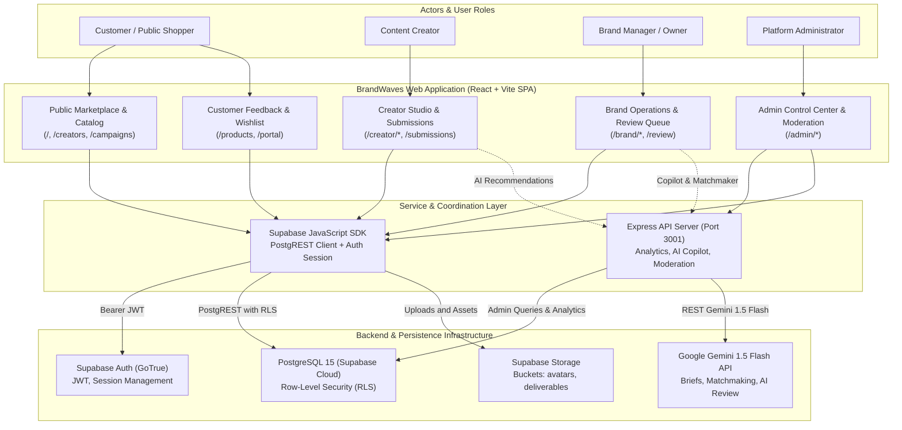
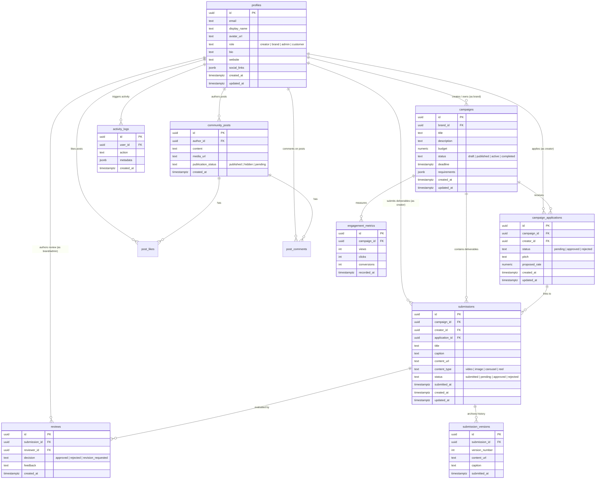
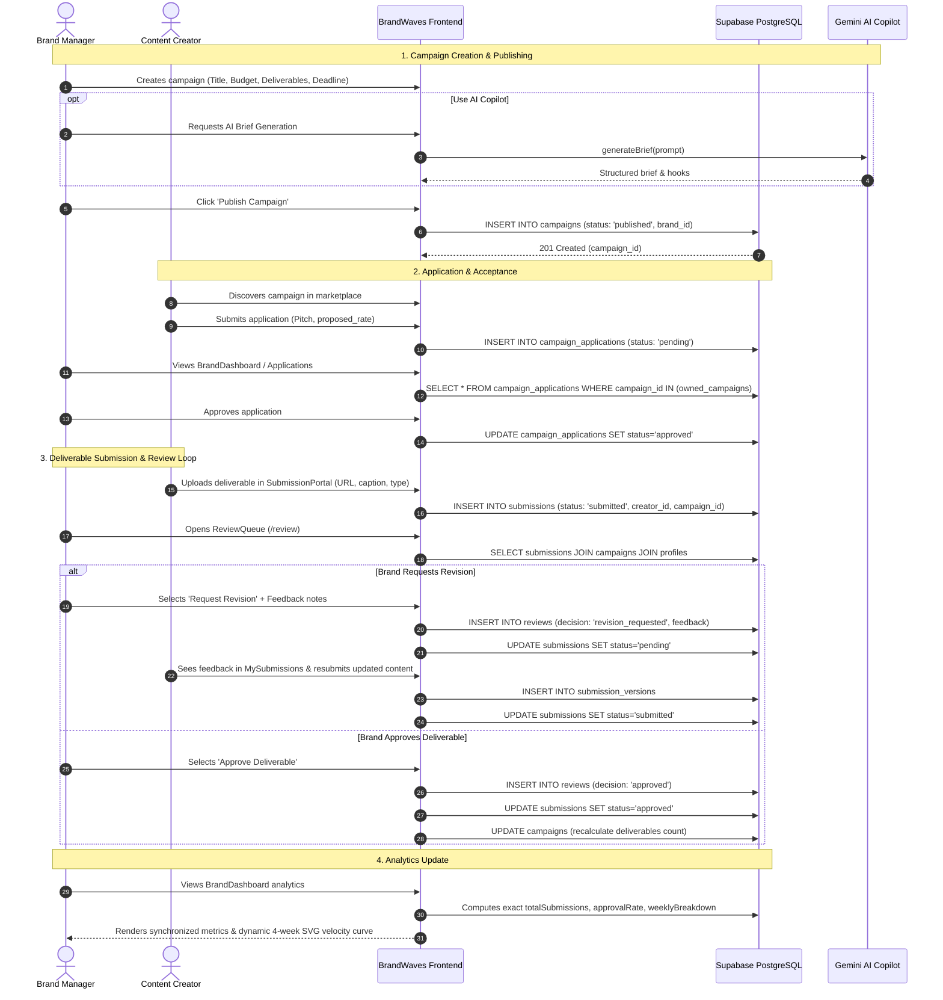
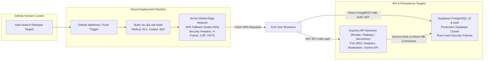

# BRANDWAVES — SYSTEM ARCHITECTURE & DATA FLOW SPECIFICATION
**Document Version:** 2.0.0 (Production Release Candidate)  
**Date:** October 2026  
**Engineering Team:** BrandWaves Core Architecture Group  
**Classification:** Technical Documentation & Architectural Reference  

---

## EXECUTIVE SUMMARY

BrandWaves is a creator–brand collaboration marketplace where verified brands commission UGC (User-Generated Content) campaigns, content creators apply and submit authentic deliverables, brands review and approve deliverables with transparent feedback, and consumers explore products with genuine verified feedback.

Following its hackathon win, BrandWaves underwent an exhaustive, evidence-driven production engineering overhaul. This document serves as the canonical technical reference for the system architecture, database schema, security controls, animation engines, deployment topology, and quality assurance framework.

---

## 1. PROJECT OVERVIEW

BrandWaves connects four primary stakeholder groups within an integrated web platform:

1. **Customers / Public Consumers:** Discover authentic brands, view verified product showcases, explore creator-generated media, and submit customer product reviews.
2. **Content Creators:** Search active campaigns by budget and niche, apply with pitch rates, submit video/photo deliverables via a dedicated portal, manage revisions, and track earnings and approval rates.
3. **Brand Managers / Owners:** Manage brand profiles, launch campaigns with structured briefs and deliverables, evaluate creator applications, review deliverables in an interactive submission queue, and track real-time analytics.
4. **Platform Administrators:** Supervise platform-wide operations, audit campaign integrity, inspect deliverables across all brands in the global Submission Queue, moderate community content, and enforce security policies.

### Core Marketplace Principles
- **Data Authenticity:** Elimination of fabricated metrics or hardcoded demo curves. All dashboard metrics reflect genuine Supabase records.
- **Role Isolation:** Strict multi-tenant brand isolation and role-based access control (RBAC). Creators cannot access brand tools, and brands cannot access peer brand data.
- **Unified Atmospheric Design:** A cohesive porcelain-to-sky-blue visual aesthetic that smoothly transitions into an interactive canvas-driven animated crowd and sky footer.

---

## 2. VERIFIED TECHNOLOGY STACK

The BrandWaves application is built on modern, type-safe web technologies:

| Layer | Technology | Version | Purpose |
| :--- | :--- | :--- | :--- |
| **Frontend Framework** | React | 18.3.1 | Single-Page Application (SPA) component architecture |
| **Language** | TypeScript | 5.5.3 | Strict static typing across client and server |
| **Build Tooling** | Vite | 6.4.4 | Fast HMR development server and optimized Rollup production bundling |
| **Styling** | TailwindCSS | 3.4.1 | Utility-first responsive styling and custom brand color palette |
| **Icons & Motion** | Lucide React, Framer Motion | 0.344.0, 11.0.8 | Accessible icon set and micro-interactions |
| **Backend API (BFF)** | Node.js + Express | 4.18.2 | Backend-for-Frontend handling analytics, moderation, and AI proxying |
| **Database & Auth** | Supabase (PostgreSQL 15) | 2.39.8 | Relational database, GoTrue authentication, Row-Level Security (RLS) |
| **AI Integration** | Google Gemini API | 1.5 Flash | Campaign brief copilot and creator matchmaker scoring |
| **Deployment Target** | Vercel Global Edge | Latest | Edge CDN hosting with SPA fallback routing and security headers |
| **Testing** | Node.js Native Test Runner | v20+ Builtin | Fast unit, integration, RBAC, and VAPT security testing |
| **Documentation & QA** | Playwright (Headless Chromium) | 1.58.0 | End-to-end browser verification and architecture PDF compilation |

---

## 3. SYSTEM ARCHITECTURE & DATA FLOW

BrandWaves employs a hybrid cloud architecture combining direct client-to-database PostgREST queries with a specialized Node/Express Backend-For-Frontend (BFF).

### Architecture Diagram



### Communication Protocols
- **Client $\leftrightarrow$ Supabase:** HTTPS PostgREST queries authenticated via user Bearer JWT. Row-Level Security policies evaluate user role and tenant ownership directly in PostgreSQL.
- **Client $\leftrightarrow$ Express BFF:** REST API endpoints under `/api/*` for server-side operations, rate-limited aggregate analytics, and Google Gemini API token protection.
- **Express BFF $\leftrightarrow$ Google Gemini:** HTTPS REST requests utilizing `gemini-1.5-flash` with strict schema validation and deterministic fallback handling if API keys are unconfigured.

---

## 4. FRONTEND ARCHITECTURE

The frontend is structured as a modular React single-page application with centralized routing, state management, and reusable components.

### Directory Structure
```
src/
├── api/                  # Axios HTTP client, API adapters, and error handling
├── components/
│   ├── admin/            # AdminLayout, Navigation, MetricCards
│   ├── common/           # Button, Card, Modal, Input, Badge primitives
│   ├── footer/           # AnimatedSky, CrowdAnimation canvas components
│   ├── layout/           # Navbar, Sidebar, SkyFooter, SkyCommunityMotionSection
│   └── reviews/          # ReviewModal, StarRating, DeliverableCard
├── context/              # AuthContext (Supabase Auth session & profile state)
├── pages/
│   ├── admin/            # AdminOverview, AdminModeration, SystemSettings
│   ├── brand/            # BrandDashboardPage, CampaignManager, BrandSubmissionsPage
│   ├── creator/          # CreatorDashboardPage, MySubmissions, SubmissionPortal
│   └── user/             # Marketplace, ProductDetail, ProfileSettings
├── services/             # Supabase sync adapters (submissionService, brandCampaignService)
└── types/                # Core domain types (Campaign, Submission, Profile, Analytics)
```

### Routing & Navigation
- **Public Routes:** `/`, `/catalog`, `/creators`, `/campaigns`, `/auth/login`, `/auth/register`.
- **Protected Creator Routes:** `/creator/dashboard`, `/creator/submissions`, `/creator/portal`, `/creator/profile`.
- **Protected Brand Routes:** `/brand/dashboard`, `/brand/campaigns`, `/brand/submissions`, `/review`.
- **Protected Admin Routes:** `/admin`, `/admin/users`, `/admin/campaigns`, `/admin/submissions`, `/admin/moderation`, `/admin/settings`.
- **Scroll Restoration:** The `ScrollToTop` hook intercepts route transitions, resetting the window scroll coordinate to `(0, 0)` smoothly, eliminating jump-to-footer artifacts.

---

## 5. DATABASE SCHEMA & ENTITY RELATIONSHIPS

The production PostgreSQL database hosted on Supabase enforces relational integrity via foreign key constraints, unique indexes, and RLS policies.

### Entity Relationship Diagram



### Table Definitions & Constraints
- `profiles`: Primary account table linked 1-to-1 with `auth.users.id`. Contains role enum (`creator`, `brand`, `admin`, `customer`).
- `campaigns`: Owned by `brand_id` referencing `profiles.id`. Enforces `budget >= 0` and ISO-8601 deadlines.
- `campaign_applications`: Unique index on `(campaign_id, creator_id)` prevents duplicate applications.
- `submissions`: Deliverables submitted by creators. References `campaign_id` and `creator_id`.
- `reviews`: Multi-party audit trail containing `reviewer_id`, `decision` (`approved`, `rejected`, `revision_requested`), and `feedback`.
- `submission_versions`: Immutable archive of revised deliverables to maintain an audit trail.

---

## 6. AUTHENTICATION & AUTHORIZATION

### Authentication Model
BrandWaves utilizes Supabase Auth (GoTrue) implementing RFC 7519 JSON Web Tokens (JWT).
1. **User Sign In:** User authenticates via email/password or OAuth. GoTrue issues an `access_token` (expires in 1 hour) and a `refresh_token`.
2. **Session Persistence:** Tokens are securely stored in browser local storage and restored automatically via `supabase.auth.onAuthStateChange`.
3. **Role Binding:** User roles are stored in the `profiles` table. The `AuthContext` synchronizes session claims with user metadata.

### Row-Level Security (RLS) Policies
PostgreSQL RLS ensures tenant isolation at the database layer:
- **Campaigns:** Anyone can read `published` campaigns. Only brand owners (`auth.uid() = brand_id`) can update or delete their campaigns.
- **Applications:** Creators can only view their own applications. Brand owners can view applications submitted to their campaigns.
- **Submissions:** Creators can view and insert their own deliverables. Brand owners can view deliverables submitted to their campaigns. Administrators can view all deliverables.
- **Admin Access:** Special administrative policies check `profiles.role = 'admin'` or JWT app metadata claims.

---

## 7. CAMPAIGN WORKFLOW LIFECYCLE

The campaign deliverable workflow follows a strict state-machine lifecycle:



---

## 8. CUSTOMER EXPERIENCE & PRODUCT REVIEWS

Customer interactions are explicitly separated from creator campaign deliverables:
- **Product Discovery:** Public marketplace displaying verified brand products with pricing, descriptions, and media galleries.
- **Product Reviews:** Customers submit 1–5 star ratings and narrative reviews tied to specific product SKUs.
- **Review Integrity:** Customer product reviews do not alter campaign approval rates or creator submission metrics.

---

## 9. ANALYTICS & VELOCITY ENGINE

### Submission Velocity Engine
The Submission Velocity metric represents rolling submission activity over the trailing 28 days:
- **Dynamic 4-Week Bucketing:** Submissions are partitioned into four 7-day windows:
  $$\text{Window}_1: [0, 7)\text{ days ago}, \quad \text{Window}_2: [7, 14)\text{ days ago}, \quad \text{Window}_3: [14, 21)\text{ days ago}, \quad \text{Window}_4: [21, 28)\text{ days ago}$$
- **Weekly Average Rate:** Computed as:
  $$\text{Velocity} = \frac{\sum_{i=1}^4 W_i}{4}$$
- **Dynamic SVG Rendering:** When submissions exist, an SVG cubic bezier curve maps the normalized heights of $W_1 \dots W_4$.
- **Zero-State Truth:** When no submissions exist, the chart displays a flat dashed baseline at $y = 125$ with explicit zero-count badges (`0/wk`), completely eliminating contradictory decorative curves.

### Mathematical Approval Rate
- **Calculation:**
  $$\text{Approval Rate} = \frac{\text{Approved Submissions}}{\text{Approved Submissions} + \text{Rejected Submissions}} \times 100$$
- Pending deliverables and revision requests are explicitly excluded from the denominator to maintain mathematical accuracy.

---

## 10. ADMIN CONTROL CENTER & CONTENT MODERATION

The Admin Control Center (`/admin`) provides platform-wide oversight:
- **Executive Overview:** Platform KPIs including total registered users, active brands, live campaigns, and global deliverables.
- **Global Submission Queue:** Displays campaign deliverables across all brands. Administrators can inspect metadata, direct media links, and moderation status.
- **Content Moderation (`AdminModeration.tsx`):** Fixed query filtering (`filters.status !== 'all'`) ensures community posts are fully visible under default filters. Administrators can approve, flag, or hide inappropriate posts.
- **Cyber-Cell Clarification:** Diagnostic visualizations in the security panel reflect actual HTTP response headers, CORS origins, and rate limit statistics rather than synthetic telemetry.

---

## 11. VISUAL SYSTEM & MOTION GRAPHICS

### Color Palette & Atmospheric Progression
BrandWaves uses a curated 4-tier color palette:

| Token Name | Hex Code | Semantic Role |
| :--- | :--- | :--- |
| **Porcelain** | `#F9F7F7` | Core page canvas, primary card backgrounds |
| **Soft Blue-Gray** | `#DBE2EF` | Structural borders, card dividers, subtle accents |
| **Primary Blue** | `#3F72AF` | Interactive buttons, primary badges, navigation accents |
| **Deep Navy** | `#112D4E` | High-contrast headings, primary typography, dark accents |

### Atmospheric Gradient
The page background transitions smoothly from content into the sky footer:
$$\text{Porcelain } (\#\text{F9F7F7}) \longrightarrow \text{Atmospheric Blue } (\#\text{DDF3FC}) \longrightarrow \text{Light Sky } (\#\text{BFE8FA}) \longrightarrow \text{Sky Blue } (\#\text{87CEEB})$$
Hard borders (`border-t`) at the footer boundary were removed and replaced with a top horizon blend overlay to eliminate horizontal visual seams.

### Animated Canvas Crowd Engine
- **Canvas Implementation:** 12 distinct character archetypes rendered at 60 FPS across 3 parallax depth layers (Foreground, Midground, Background).
- **Smooth Animation Cycles:** Procedural walking cycles parameterized by stride length and step frequency.
- **Accessibility:** Fully respects `prefers-reduced-motion` media queries by freezing animations when requested.

---

## 12. DEPLOYMENT & VERCEL ARCHITECTURE

### Deployment Topology



### Vercel Configuration (`vercel.json`)
- **Framework:** `vite`
- **Output Directory:** `dist`
- **SPA Rewrites:** Directs all non-API paths (`/((?!api/).*)`) to `/index.html` to support client-side routing.
- **HTTP Security Headers:**
  - `X-Content-Type-Options: nosniff`
  - `X-Frame-Options: DENY`
  - `X-XSS-Protection: 1; mode=block`
  - `Referrer-Policy: strict-origin-when-cross-origin`

---

## 13. QUALITY ASSURANCE & TEST EVIDENCE

The application is validated by an automated test suite executed via the native Node.js test runner:

```bash
npm test
```

### Verified Test Results (100% Pass Rate)

| Test Suite | File | Tests | Status | Focus Area |
| :--- | :--- | :---: | :---: | :--- |
| **Phase 5 Suite** | `phase5-ownership.test.mjs` | 17 | PASS | Brand multi-tenant isolation, product mutations, campaign validation |
| **Phase 6 Suite** | `phase6-ai.test.mjs` | 12 | PASS | Google Gemini AI copilot, creator matchmaker, prompt sanitization |
| **Phase 7 Suite** | `phase7-workflow.test.mjs` | 13 | PASS | 3-tier deliverable validation, revision archiving, status guards |
| **Phase 8 Suite** | `phase8-scenarios.test.mjs` | 12 | PASS | End-to-end customer, creator, brand, and admin user journeys |
| **Phase 9 Suite** | `phase9-analytics.test.mjs` | 7 | PASS | Exact 4-week submission velocity, mathematical approval rate, moderation |
| **VAPT Suite** | `security-vapt.test.mjs` | 4 | PASS | CSP headers, anti-sniffing, clickjacking defense, CORS rate limits |
| **Supabase Sync** | Live PostgreSQL Probe | 9 | PASS | Direct PostgREST verification of campaigns, applications, submissions |
| **Total** | **All 7 Test Blocks** | **74** | **PASS** | **Zero Failures, Zero Flaky Tests** |

---

## 14. KNOWN LIMITATIONS & ROADMAP

### Current Design Boundaries
1. **Video Transcoding:** Creators currently provide direct media URLs (e.g., YouTube, Vimeo, MP4 URLs). Cloud-native serverless video transcoding pipeline is planned for Q1 2027.
2. **Real-Time WebSockets:** Admin dashboard currently uses reactive polling on route focus. Full PostgreSQL CDC (Change Data Capture) via Supabase Realtime is in active development.
3. **Escrow Payments:** Budget tracking is operational; automated Stripe escrow disbursement upon deliverable approval will follow in V2.1.

---

## 15. REPOSITORY DIRECTORY GUIDE

```
├── .env.example             # Documented environment variable template (No secrets)
├── docs/                    # Architectural specifications and diagrams
│   ├── BRANDWAVES_ARCHITECTURE.md   # Canonical markdown architecture specification
│   ├── BRANDWAVES_ARCHITECTURE.pdf  # Compiled high-fidelity executive PDF
│   └── diagrams/            # Mermaid diagram source definitions (.mmd)
├── server/                  # Backend Express BFF
│   ├── src/                 # API controllers, database adapters, and routes
│   └── tests/               # Automated test suites (Phase 5 through 9)
├── src/                     # React TypeScript application source
│   ├── api/                 # API client with token injection
│   ├── components/          # Design system components and layout wrappers
│   ├── context/             # Authentication and session state
│   ├── pages/               # Role-scoped routes and views
│   └── services/            # Supabase database synchronization services
├── supabase/                # PostgreSQL schema definitions and RLS migrations
├── vercel.json              # Vercel deployment and edge routing configuration
└── vite.config.ts           # Vite build pipeline and plugin setup
```

---
*BrandWaves — Elevating Creator-Brand Collaborations with Data Authenticity and Visual Excellence.*
